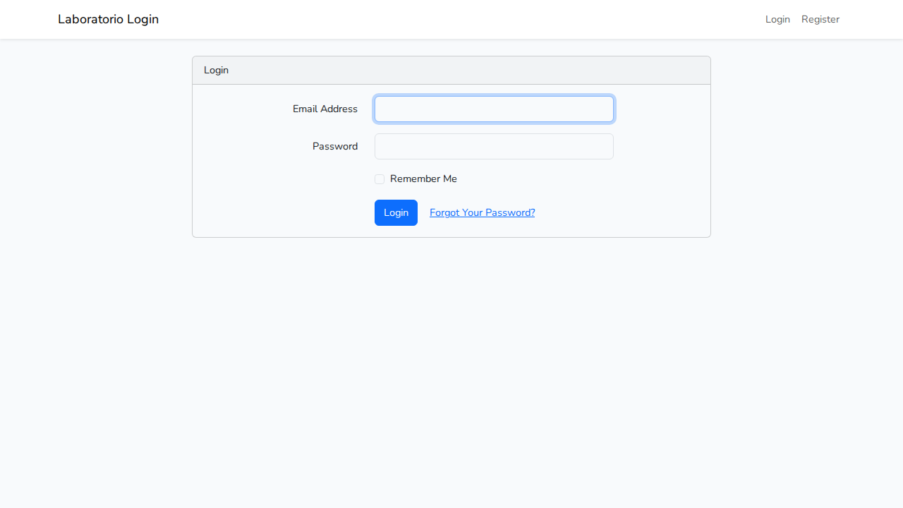
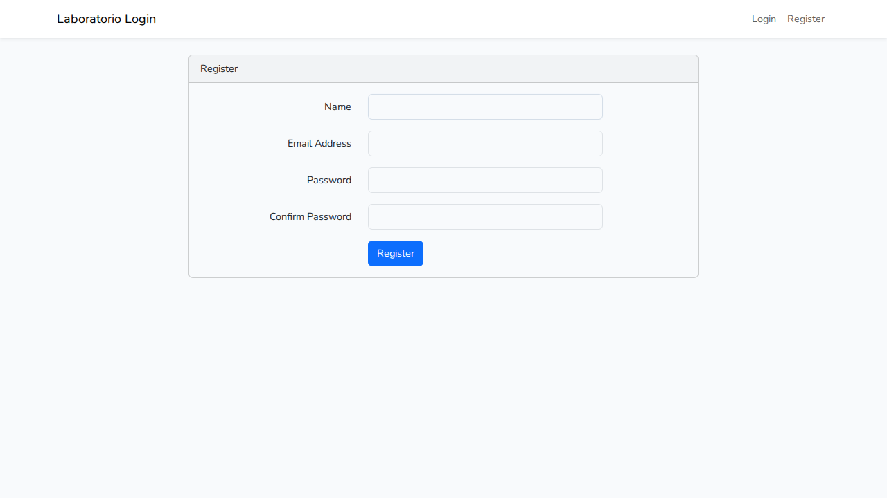
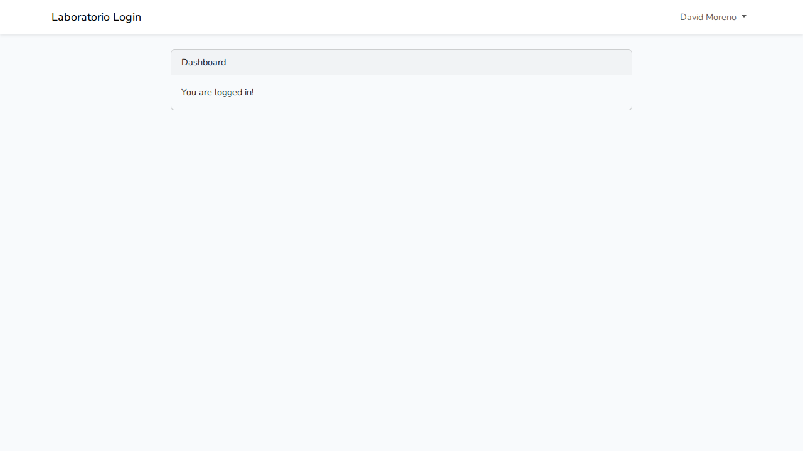

<div align="center">

# 🔐 Laboratorio #2 – Login y Registro en Laravel

**Universidad Tecnológica de Panamá**<br>
Facultad de Ingeniería de Sistemas Computacionales · Campus Víctor Levi Sasso<br>
Desarrollo Web · II Semestre 2026 · Unidad I: Modelo Vista Controlador (MVC)


</div>

---

## 📑 Contenido

1. [Introducción](#-introducción)
2. [Objetivo del laboratorio](#-objetivo-del-laboratorio)
3. [Requisitos previos](#-requisitos-previos)
4. [Flujo de comandos utilizado](#️-flujo-de-comandos-utilizado)
5. [Arquitectura MVC en Laravel](#️-arquitectura-mvc-en-laravel)
6. [Código implementado](#-código-implementado)
7. [Base de datos](#️-base-de-datos)
8. [Resultados](#-resultados)
9. [Dificultades y soluciones](#-dificultades-y-soluciones)
10. [Cómo ejecutar el proyecto](#️-cómo-ejecutar-el-proyecto)
11. [Referencias](#-referencias)
12. [Fecha de ejecución](#-fecha-de-ejecución)

---

## 📖 Introducción

Laravel es un framework de PHP que organiza las aplicaciones con el patrón
**Modelo–Vista–Controlador (MVC)**. Este patrón separa la lógica de datos, la presentación
y el control de las peticiones, lo que facilita mantener y reutilizar el código.

En este laboratorio se creó un proyecto Laravel desde cero, se conectó a una base de datos
MySQL, se ejecutaron las migraciones que trae el framework y se agregó un módulo de
autenticación (registro, inicio y cierre de sesión) con el paquete oficial **laravel/ui** y
Bootstrap.

## 🎯 Objetivo del laboratorio

Identificar la estructura básica de un proyecto en Laravel, comprender cómo se organiza
bajo el patrón MVC e implementar un **login y registro de usuarios** funcional, guardando
los usuarios en una base de datos MySQL.

---

## 🧰 Requisitos previos

Ecosistema de desarrollo con el que se realizó el laboratorio:

| Tecnología | Versión usada | Uso en el laboratorio |
|---|---|---|
| 🐘 **PHP** | 8.5.4 (se requiere 8.3 o superior) | Lenguaje del framework |
| 🎼 **Composer** | 2.9.5 | Descarga de Laravel y sus dependencias |
| 🔴 **Laravel** | 13.36.0 (creado con `composer create-project`) | Framework MVC |
| 🔑 **laravel/ui** | 4.6.3 | Vistas y controladores de autenticación |
| 🐬 **MySQL** | 8.4.11 | Base de datos |
| 🟢 **Node.js / npm** | 22.22.1 / 9.2.0 | Compilar Bootstrap con Vite |
| 🌐 **Servidor web** | Servidor integrado de PHP (`php artisan serve`) | Levantar la aplicación en `http://127.0.0.1:8000` |
| 🐧 **Sistema operativo** | Ubuntu 26.04 LTS | — |
| 📝 **Editor** | Visual Studio Code | — |

> En Linux no se usó XAMPP ni WampServer: MySQL está instalado como servicio del sistema y
> la aplicación se sirve con `php artisan serve`. En Windows el equivalente es tener los
> servicios de XAMPP/WAMP levantados y crear el proyecto dentro de `htdocs` o `www`.

### Extensiones de PHP necesarias

Laravel necesita las extensiones `mbstring`, `xml` (dom), `curl`, `zip` y `pdo_mysql`.
En Ubuntu se instalaron junto con Composer:

```bash
sudo apt install -y php-mbstring php-xml php-curl php-zip composer
```

---

## ⚙️ Flujo de comandos utilizado

### 1. Crear la base de datos y un usuario para el proyecto

```sql
CREATE DATABASE laravel_login CHARACTER SET utf8mb4 COLLATE utf8mb4_unicode_ci;
CREATE USER 'laravel'@'localhost' IDENTIFIED BY '********';
GRANT ALL PRIVILEGES ON laravel_login.* TO 'laravel'@'localhost';
FLUSH PRIVILEGES;
```

### 2. Crear el proyecto Laravel

```bash
composer create-project laravel/laravel Laboratorio-Laravel-Login
cd Laboratorio-Laravel-Login
php artisan --version     # Laravel Framework 13.36.0
```

### 3. Configurar el archivo `.env` y migrar

```bash
# editar .env (ver sección Base de datos)
php artisan config:clear
php artisan migrate
```

### 4. Instalar el paquete de autenticación (laravel/ui)

```bash
composer require laravel/ui
php artisan ui bootstrap --auth
npm install
npm run build             # o npm run dev mientras se desarrolla
```

### 5. Levantar el servidor

```bash
php artisan serve         # http://127.0.0.1:8000
```

> En Laravel 13 también existe `composer run dev`, que levanta a la vez el servidor de
> PHP y Vite en una sola terminal.

---

## 🏗️ Arquitectura MVC en Laravel

```
Laboratorio-Laravel-Login/
├── app/
│   ├── Http/Controllers/        ← CONTROLADORES
│   │   ├── HomeController.php
│   │   └── Auth/                (Login, Register, ForgotPassword, ResetPassword…)
│   ├── Models/                  ← MODELOS
│   │   └── User.php
│   └── Providers/AppServiceProvider.php
├── database/
│   ├── migrations/              ← estructura de las tablas
│   └── backup/laravel_login.sql ← respaldo de la base de datos
├── resources/
│   ├── views/                   ← VISTAS (Blade)
│   │   ├── layouts/app.blade.php
│   │   ├── auth/login.blade.php
│   │   ├── auth/register.blade.php
│   │   └── home.blade.php
│   ├── sass/app.scss            (Bootstrap)
│   └── js/app.js
├── routes/
│   └── web.php                  ← RUTAS
└── .env                         ← variables de entorno (no se sube al repositorio)
```

| Carpeta | Capa | Función |
|---|---|---|
| `app/Models` | **Modelo** | Representa los datos y se comunica con la base de datos mediante Eloquent. `User.php` corresponde a la tabla `users`. |
| `resources/views` | **Vista** | Plantillas Blade con el HTML que ve el usuario (formularios de login y registro, panel de inicio). |
| `app/Http/Controllers` | **Controlador** | Recibe la petición, valida los datos, usa el modelo y devuelve una vista o una redirección. |
| `routes/web.php` | Rutas | Asocia cada URL con el controlador que la atiende. |
| `database/migrations` | Base de datos | Define en PHP las tablas que Laravel crea con `php artisan migrate`. |

**Flujo de una petición:** el navegador pide `/login` → `routes/web.php` la envía a
`LoginController` → el controlador muestra la vista `auth/login.blade.php` → al enviar el
formulario, el controlador valida las credenciales contra el modelo `User` → si son
correctas redirige a `/home`.

---

## 💻 Código implementado

### Rutas – `routes/web.php`

```php
Route::redirect('/', '/login');

Auth::routes();

Route::get('/home', [App\Http\Controllers\HomeController::class, 'index'])->name('home');
```

### Controlador protegido – `app/Http/Controllers/HomeController.php`

```php
public function __construct()
{
    // solo entran usuarios con sesión iniciada
    $this->middleware('auth');
}

public function index()
{
    return view('home');
}
```

### Validación y registro – `app/Http/Controllers/Auth/RegisterController.php`

```php
// reglas del formulario de registro
protected function validator(array $data)
{
    return Validator::make($data, [
        'name' => ['required', 'string', 'max:255'],
        'email' => ['required', 'string', 'email', 'max:255', 'unique:users'],
        'password' => ['required', 'string', 'min:8', 'confirmed'],
    ]);
}

// guarda el usuario con la contraseña encriptada
protected function create(array $data)
{
    return User::create([
        'name' => $data['name'],
        'email' => $data['email'],
        'password' => Hash::make($data['password']),
    ]);
}
```

### Longitud de cadena – `app/Providers/AppServiceProvider.php`

Configuración preventiva indicada en la guía, para evitar el error
*"Specified key was too long"* en versiones antiguas de MySQL/MariaDB:

```php
use Illuminate\Support\Facades\Schema;

public function boot(): void
{
    Schema::defaultStringLength(191);
}
```

### JavaScript – `resources/js/app.js`

```js
import './bootstrap';   // carga Bootstrap (menú desplegable de "Logout") y axios
```

---

## 🗄️ Base de datos

### Variables de entorno (`.env`)

Laravel 13 viene configurado con SQLite. Se cambió la conexión a MySQL:

```env
DB_CONNECTION=mysql
DB_HOST=127.0.0.1
DB_PORT=3306
DB_DATABASE=laravel_login
DB_USERNAME=laravel
DB_PASSWORD=********
```

- `DB_PORT` debe coincidir con el puerto de MySQL (3306 por defecto).
- El archivo `.env` **no se sube** al repositorio porque contiene credenciales; se incluye
  `.env.example` como plantilla.
- Después de editar `.env` se ejecuta `php artisan config:clear` para que Laravel lea
  los nuevos valores.

### Migraciones

```bash
php artisan migrate            # ejecuta las migraciones pendientes
php artisan migrate:status     # muestra cuáles se aplicaron
php artisan migrate:rollback   # revierte el último lote (método down())
```

Salida obtenida:

```
 Creating migration table ............................ DONE
 0001_01_01_000000_create_users_table ................ DONE
 0001_01_01_000001_create_cache_table ................ DONE
 0001_01_01_000002_create_jobs_table ................. DONE
```

Tablas creadas en `laravel_login`:

| Tabla | Uso |
|---|---|
| `users` | Usuarios registrados (nombre, correo, contraseña con hash bcrypt) |
| `password_reset_tokens` | Tokens para recuperar la contraseña |
| `sessions` | Sesiones activas |
| `migrations` | Control de las migraciones aplicadas |
| `cache`, `cache_locks` | Caché de la aplicación |
| `jobs`, `job_batches`, `failed_jobs` | Colas de trabajo |

### 💾 Respaldo (backup)

El respaldo está en [`database/backup/laravel_login.sql`](database/backup/laravel_login.sql)
y se generó con:

```bash
mysqldump -u laravel -p --no-tablespaces --single-transaction laravel_login > database/backup/laravel_login.sql
```

Para restaurarlo:

```bash
mysql -u root -p -e "CREATE DATABASE laravel_login"
mysql -u root -p laravel_login < database/backup/laravel_login.sql
```

El respaldo incluye un usuario de prueba: **david@example.com** / **Laboratorio2026**.

---

## ✅ Resultados

### Página de inicio de sesión


### Página de registro


### Usuario autenticado


### Pruebas realizadas

| Prueba | Resultado |
|---|---|
| Registrar un usuario nuevo | ✅ Se crea en la tabla `users` y redirige a `/home` |
| Contraseña guardada | ✅ Se almacena con hash bcrypt (`$2y$12$…`), nunca en texto plano |
| Cerrar sesión (Logout) | ✅ Termina la sesión |
| Entrar a `/home` sin sesión | ✅ Redirige a `/login` |
| Login con contraseña incorrecta | ✅ Rechazado, vuelve a `/login` con mensaje de error |
| Login con credenciales correctas | ✅ Redirige a `/home` ("You are logged in!") |

---

## 🧩 Dificultades y soluciones

- **Dificultad 1:** faltaban extensiones de PHP (`mbstring`, `xml`, `curl`, `zip`) y
  Composer no estaba instalado, por lo que no se podía crear el proyecto.
  - **Solución:** se instalaron con `sudo apt install php-mbstring php-xml php-curl php-zip composer`.

- **Dificultad 2:** al crear el proyecto apareció
  `WARN could not find driver (Connection: sqlite ...)`, porque Laravel 13 usa SQLite por
  defecto y PHP no tenía el driver de SQLite.
  - **Solución:** se cambió `DB_CONNECTION=mysql` en el `.env` con los datos de la base
    `laravel_login` y se borró el archivo `database/database.sqlite`.

- **Dificultad 3:** `ERROR 1698 (28000): Access denied for user 'root'@'localhost'`. En
  Ubuntu el usuario `root` de MySQL entra por *auth_socket* (solo con `sudo`) y Laravel
  no puede conectarse con él.
  - **Solución:** se creó un usuario `laravel` con contraseña y permisos únicamente sobre
    la base `laravel_login`.

- **Dificultad 4:** después de `php artisan ui bootstrap --auth`, el archivo
  `resources/js/app.js` de Laravel 13 venía vacío y `npm run build` generaba un JS de
  0 kB, así que no cargaba el JavaScript de Bootstrap (el menú desplegable con el botón
  *Logout* no abría).
  - **Solución:** se agregó `import './bootstrap';` en `resources/js/app.js` y se volvió a
    compilar con `npm run build`.

- **Dificultad 5:** la guía menciona Laravel Mix (`webpack.mix.js`), pero las versiones
  actuales de Laravel usan **Vite**.
  - **Solución:** `laravel/ui` 4.6 ya configura `vite.config.js` con
    `resources/sass/app.scss` y `resources/js/app.js`; se compiló con `npm run build`.

---

## ▶️ Cómo ejecutar el proyecto

```bash
git clone https://github.com/D4m0p/Laravel.git
cd Laravel
composer install
cp .env.example .env          # ajustar DB_USERNAME y DB_PASSWORD
php artisan key:generate
php artisan migrate           # o restaurar database/backup/laravel_login.sql
npm install
npm run build
php artisan serve
```

Abrir `http://127.0.0.1:8000` y usar **Login** o **Register**.

---

## 📚 Referencias

1. Laravel. *Installation*. Documentación oficial. https://laravel.com/docs/13.x/installation
2. Laravel. *Database: Migrations*. https://laravel.com/docs/13.x/migrations
3. Laravel. *laravel/ui – Legacy frontend scaffolding*. GitHub. https://github.com/laravel/ui
4. Laravel. *Asset Bundling (Vite)*. https://laravel.com/docs/13.x/vite
5. Composer. *Getting Started*. https://getcomposer.org/doc/00-intro.md
6. Fong, I. (2026). *Guía de Laboratorio: Cómo crear un Login y Registro en Laravel*. Universidad Tecnológica de Panamá.

---

## 📅 Fecha de ejecución

El laboratorio se realizó el **14 de octubre de 2026**.

---

<div align="center">

**Este laboratorio ha sido desarrollado por el estudiante de la Universidad Tecnológica de Panamá:**

**Nombre:** David Moreno<br>
**Correo:** dmeli8930@gmail.com<br>
**Curso:** Desarrollo Web<br>
**Instructor del Laboratorio:** Irina Fong

</div>
